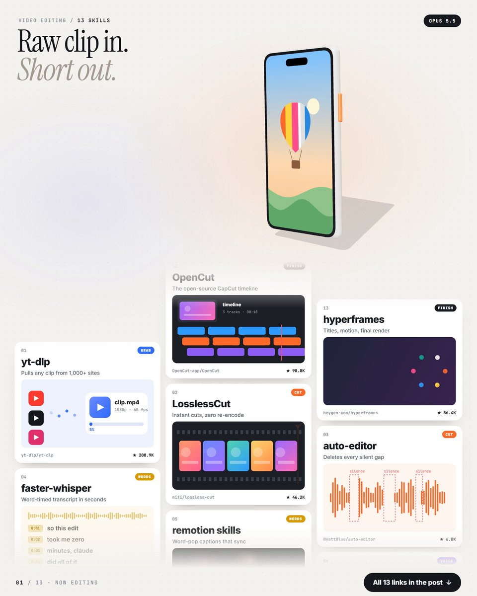
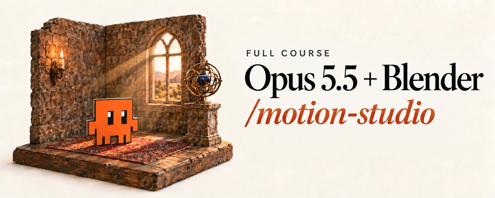
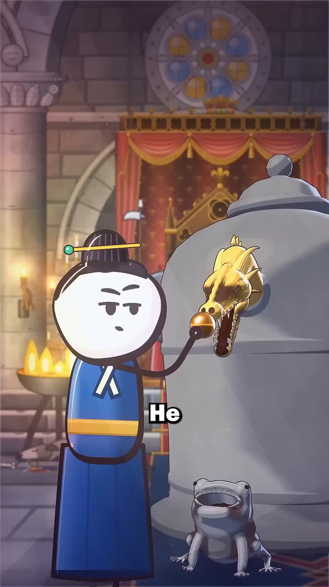
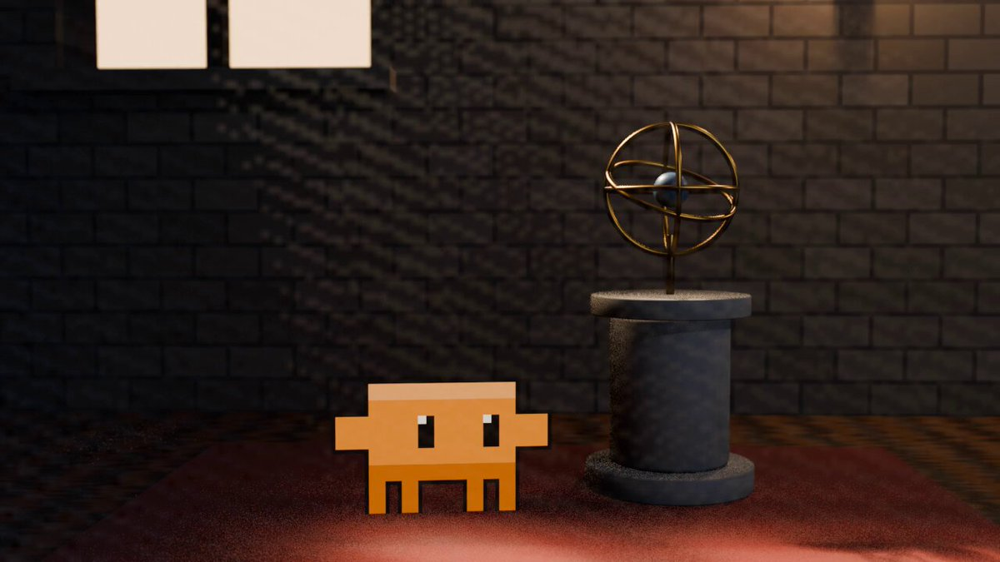
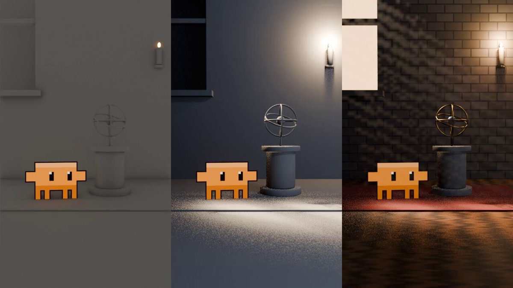
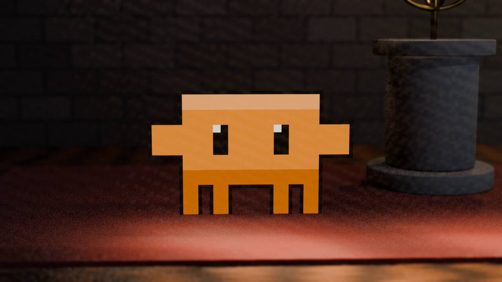
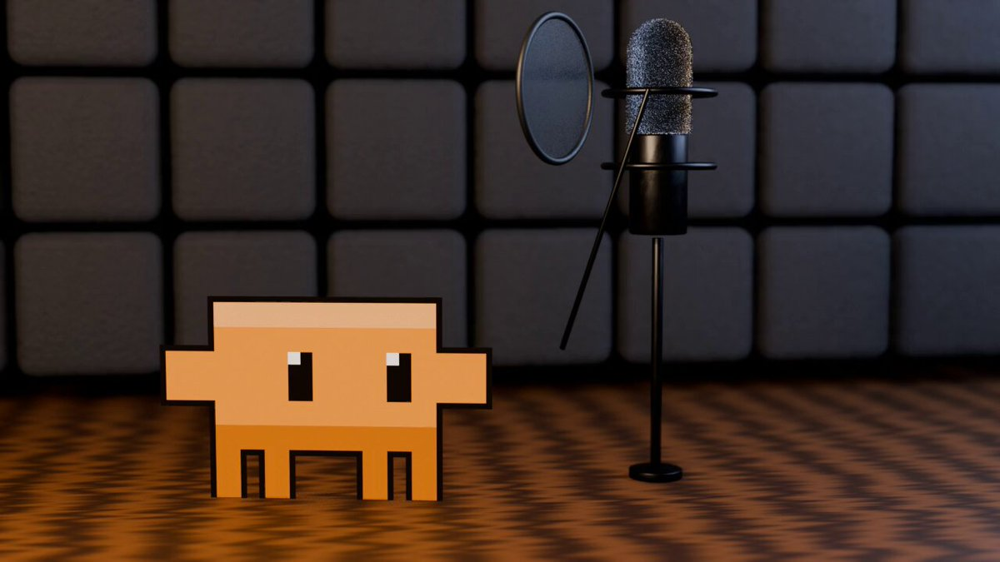
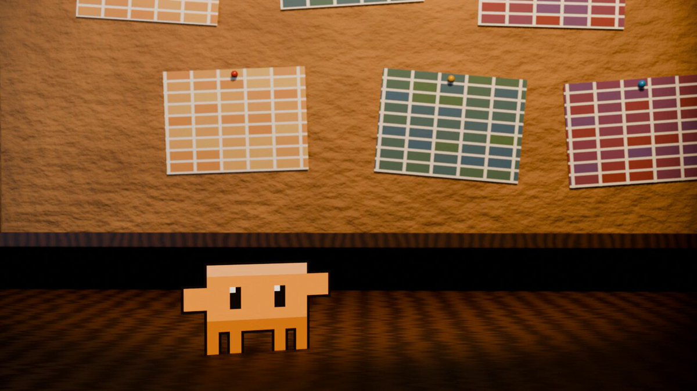
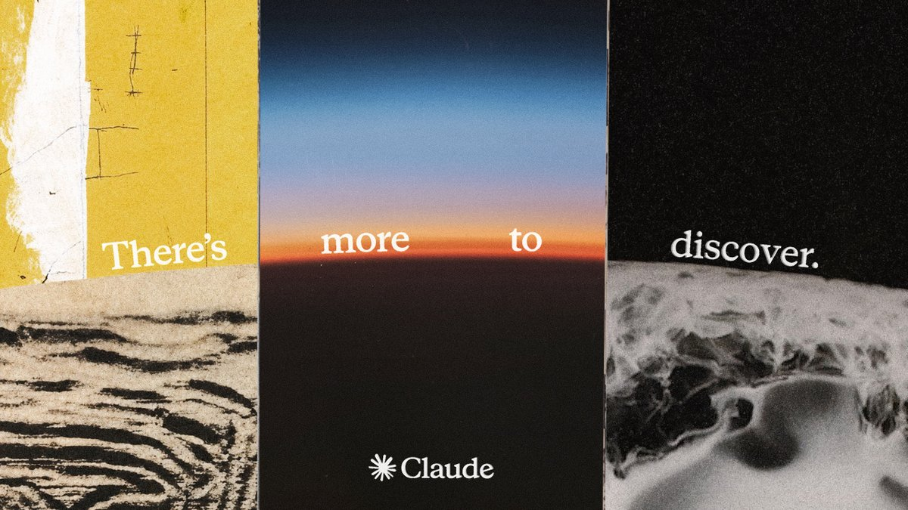

<div align="center">

# Opus 5.5 Knowledge Hub

**Everything worth keeping about Claude Opus 5.5, archived in full from X: guides, prompts, repos and every video.**


[**▶ Open the website**](https://raw.githack.com/HossamSalemOnline/Opus-5.5/main/docs/index.html) · [**All repos**](REPOS.md) · [**Sources**](sources/SOURCES.md) · [**How entries are added**](HOW-TO-ADD.md)

</div>

---

<!-- AUTO:START (generated by tools/build_site.py; edit sources/entries.json instead) -->

**2 entries · 10 videos · 9 images · 23 unique repos**

## Entries

| | Entry | Type | Author | Date |
|---|---|---|---|---|
|  | **[Claude Opus 5.5 + 13 free GitHub repos = your own editing desk](content/e001-13-repos-editing-desk.md)**<br><sub>A free, open-source CapCut replacement: 13 repos covering grab, cut, transcribe, caption, voice, clean, grade and render.</sub> | Post | [@Y0urDumble](https://x.com/Y0urDumble) | 2026-11-18 |
|  | **[How to build a 2.5D motion studio with Opus 5.5 (Full Course)](content/e002-2-5d-motion-studio-course.md)**<br><sub>A 9-part course on the 27M-view 2.5D shorts format: flat 2D characters in lit 3D Blender sets. House rules, story and shot-list prompts, Blender MCP set passes, cut-out rigs, word-timed captions, sound cues and the frame-by-frame review loop, plus a ready SKILL.md.</sub> | Article | [@Y0urDumble](https://x.com/Y0urDumble) | 2026-10-27 |

## Watch

| | | |
|:---:|:---:|:---:|
| [](https://raw.githack.com/HossamSalemOnline/Opus-5.5/main/docs/media/e001-editing-desk.mp4)<br><sub>13-repo editing desk</sub> | [](https://raw.githack.com/HossamSalemOnline/Opus-5.5/main/docs/media/e002-v1-bronze-jar-short.mp4)<br><sub>The 27M-view bronze jar short</sub> | [](https://raw.githack.com/HossamSalemOnline/Opus-5.5/main/docs/media/e002-v2-part1.mp4)<br><sub>Part 1 title card</sub> |
| [](https://raw.githack.com/HossamSalemOnline/Opus-5.5/main/docs/media/e002-v3-part3.mp4)<br><sub>Part 3 title card</sub> | [](https://raw.githack.com/HossamSalemOnline/Opus-5.5/main/docs/media/e002-v4-part4.mp4)<br><sub>Part 4 title card</sub> | [](https://raw.githack.com/HossamSalemOnline/Opus-5.5/main/docs/media/e002-v5-part5.mp4)<br><sub>Part 5 title card</sub> |
| [](https://raw.githack.com/HossamSalemOnline/Opus-5.5/main/docs/media/e002-v6-part6.mp4)<br><sub>Part 6 title card</sub> | [](https://raw.githack.com/HossamSalemOnline/Opus-5.5/main/docs/media/e002-v7-part7.mp4)<br><sub>Part 7 title card</sub> | [](https://raw.githack.com/HossamSalemOnline/Opus-5.5/main/docs/media/ref-claude-opus-5.5-launch.mp4)<br><sub>Claude Opus 5.5 launch</sub> |

<sub>Tap a thumbnail to play it. The full list of 23 repos is in [REPOS.md](REPOS.md).</sub>

<!-- AUTO:END -->

---

## How this hub works

| | |
|---|---|
| 📚 **Entries** | Each X post or article lives in `content/` as a verbatim Markdown file, with every link expanded and every video and image in place. |
| 🎞 **Media** | Every video, image and PDF is stored in this repo under `docs/media/`. Nothing depends on X staying online. |
| 🧰 **Repo index** | [REPOS.md](REPOS.md) collects every GitHub repo mentioned across all entries, so you can see which tools keep coming up. |
| 🌐 **Website** | `docs/` is a designed site with videos playing inline and copy buttons on every prompt. |
| ⚙️ **Automation** | On every push, GitHub Actions downloads any new media, switches links to local copies and rebuilds the README, REPOS.md and the website. |

## Repository layout

```text
.
├── README.md                  ← this page (the Entries and Watch sections are generated)
├── REPOS.md                   ← every GitHub repo across all entries (generated)
├── HOW-TO-ADD.md              ← how a new X post becomes an entry
├── content/                   ← one verbatim Markdown file per entry
├── sources/
│   ├── entries.json           ← the list of entries that drives everything
│   ├── media-manifest.json    ← every media file: original URL + Apify backup
│   └── SOURCES.md             ← capture log and original URLs
├── tools/
│   ├── fetch_media.py         ← downloads media into docs/media/
│   └── build_site.py          ← rebuilds docs/, REPOS.md and the README sections
├── .github/workflows/
│   └── fetch-media.yml        ← runs both tools on every push
└── docs/                      ← website + docs/media/
```

---

<div align="center"><sub>All archived content © its original authors. Captured from X for personal reference.</sub></div>
