# How to build a 2.5D motion studio with Opus 5.5 (Full Course)

<p align="center">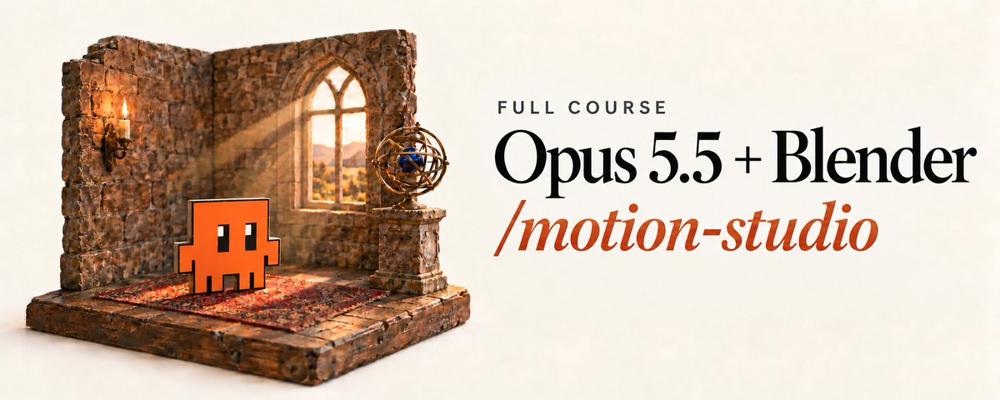</p>

- **Author:** Dumble ([@Y0urDumble](https://x.com/Y0urDumble))
- **Published:** Tue 27 Oct 2026, 19:33 UTC (X Article)
- **Source:** https://x.com/Y0urDumble/status/2115164938884862375
- **Announcement post:** "this is the most underrated format on youtube right now / a 65-second cartoon about a bronze jar got 27M views in 8 days / 2D characters. lit 3D sets. one voice. a true story. / here's the full course: prompts, skills and the review loop ↓"
- **Stats at capture (19 Nov 2026):** 1,193,765 views · 1,113 likes · 233 reposts · 24 quotes · 17 replies · 3,430 bookmarks
- **Captured via:** Apify (`xquik/x-article-scraper`, full content blocks). Embedded posts captured with `xquik/x-tweet-scraper` and shown in place.
- **Note:** text is verbatim. The only change: the word "copy" that X's copy button appended to the end of each code block has been removed. "09. The cut-out ri" is truncated in the original and kept as is.

---

A 65-second cartoon about a bronze jar went up on YouTube on October 19.

Eight days later it had 27 million views.

A flat cartoon guy with a round head, standing in a throne room that looks like it was lit by a film crew, telling the true story of a jar that warned an empire.

<p align="center"><a href="https://raw.githack.com/HossamSalemOnline/Opus-5.5/main/docs/media/e002-v1-bronze-jar-short.mp4">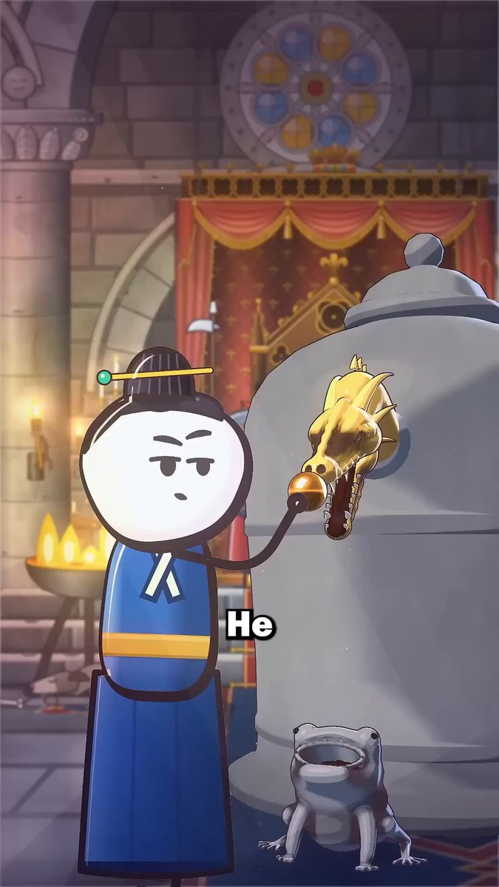</a><br>
<sub>▶ The 27M-view bronze jar short, 65 s, 1080x1920 · <a href="https://raw.githack.com/HossamSalemOnline/Opus-5.5/main/docs/media/e002-v1-bronze-jar-short.mp4">MP4</a></sub></p>

The same channel, Ricks Clips, has more shorts in the same format at 13M, 10M and 10M views.

I went through that video frame by frame. The format is not magic, and almost every part of it can now be built with Opus 5.5, Blender and a handful of open-source skills.

This course shows you how, step by step, with the real repos, the real prompts and the mistakes that get you called slop in the replies.

> **One honest note before we start:** I don't know the exact pipeline behind Ricks Clips, and nobody outside the channel does. What follows is the open-source way to build the same format yourself.

Here is where all of this starts:

> **[Embedded post]** [@claudeai](https://x.com/claudeai/status/2102435511222890900) · Tue 22 Sep 2026 · 29,725,802 views · 98,375 likes
>
> Introducing Claude Opus 5.5, the first model in our new Claude 5.5 family.
>
> It performs at the level of Claude Fable 5.1 for most tasks, and costs 40% less to run than Opus 5.

<p align="center"><a href="https://raw.githack.com/HossamSalemOnline/Opus-5.5/main/docs/media/ref-claude-opus-5.5-launch.mp4"></a><br>
<sub>▶ Claude Opus 5.5 launch, 20 s, 1920x1080 · <a href="https://raw.githack.com/HossamSalemOnline/Opus-5.5/main/docs/media/ref-claude-opus-5.5-launch.mp4">MP4</a></sub></p>

## Part 1 - Why this format works

<p align="center"><a href="https://raw.githack.com/HossamSalemOnline/Opus-5.5/main/docs/media/e002-v2-part1.mp4">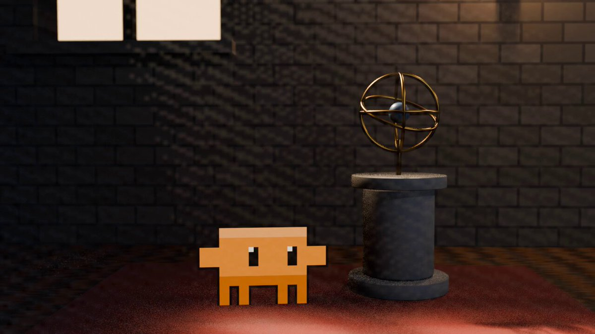</a><br>
<sub>▶ Part 1 title card, 4 s · <a href="https://raw.githack.com/HossamSalemOnline/Opus-5.5/main/docs/media/e002-v2-part1.mp4">MP4</a></sub></p>

### 01. Anatomy of a 27M-view short

I cut the jar video into one frame per second and laid all 65 on a sheet. This is what is actually on screen:

```
FORMAT        1080x1920, 30 fps, 65 seconds
STORY         one true story from history, told in one voice
CHARACTERS    flat 2D: round heads, dot eyes, thick outlines, stick limbs
SETS          full 3D: lit throne rooms, castles, crowds, depth of field
MIX           2D characters standing inside 3D-lit worlds (2.5D)
CUTS          a new shot roughly every 2 seconds
CAMERA        slow push-ins and dolly moves, never random drift
CAPTIONS      1-2 words at a time, bold white, centre-low
HOOK          a question in the title: why / how / what really happened
```

<p align="center">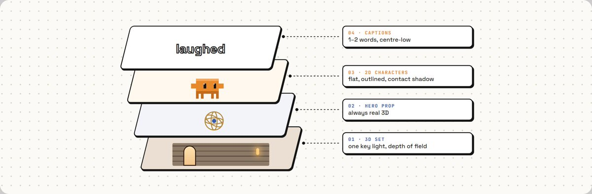</p>

The story, by the way, is real. It's Zhang Heng's seismoscope from 132 AD: a bronze jar with eight dragons holding balls over eight frogs. When the ground shook, a ball dropped into a frog's mouth and showed the direction of the quake. [Zhang Heng, Wikipedia](https://en.wikipedia.org/wiki/Zhang_Heng)

That is the first lesson. The viewer gets a fact they can repeat at dinner. The animation is the delivery, not the point.

You can run the same breakdown on any reference with Claude Code.

Extract the frames first:

```
ffmpeg -i reference.mp4 -vf "fps=2,scale=540:-2" frames/ref-%04d.jpg
```

Then paste this:

```
Analyze reference.mp4 as a format, not as content to copy.
First report its size, frame rate and duration with ffprobe.
Open the frames in frames/ and look at them.

Save REFERENCE.md with:
- every cut, with timestamp and frame number
- what is 2D and what is 3D in each shot
- camera move per shot (static / push-in / dolly / pan) and its direction
- caption style: words per card, position, when a card changes
- the hook line and where the twist lands

Label every value as MEASURED (read from a frame), ESTIMATED (by eye)
or DECISION (my creative choice for our version). For anything uncertain,
name the exact frames I should check.
```

Never copy characters, designs, script or story structure 1:1.
End with 5 decisions for our own original episode.

Keep the labels. Claude's spatial estimates from images are approximate, so anything you will build on should be checked against the frame. [Claude vision docs](https://platform.claude.com/docs/en/build-with-claude/vision)

### 02. Why it doesn't read as AI slop

Most AI animation dies in the first two seconds because it looks like every other AI animation. This format survives because it breaks the usual tells:

- **The characters are deliberately simple.** Nobody expects realism from a round-head cartoon, so nothing looks uncanny.
- **The sets are deliberately rich.** Warm light, real materials, depth. That contrast is the signature.
- **Every shot has a reason.** A new shot lands on a new idea in the script, not on a timer.
- **One human voice.** The channel description literally says Rick is a regular guy who loves doing voiceovers.
- **A true story.** Facts can be checked. That alone earns more trust than any effect.

Keep those five in mind. Every step below protects one of them.

## Part 2 - Set up the studio

### 03. Install only what the film needs

Skills are code that runs with your agent. Open each repo and read it before you install it.

```
# Let Claude drive Blender (Blender 4.2+, uv)
uvx mcp-for-blender setup
# manual: claude mcp add blender uvx mcp-for-blender
#         uvx mcp-for-blender install-addon

# Taste: timing, easing, Disney's 12 principles for agents
npx skills add LottieFiles/motion-design-skill

# Assemble picture, captions and sound
npx skills add remotion-dev/skills

# Word-level timestamps for the captions
pip install -U openai-whisper
```

Then open Claude Code on Opus 5.5. Use xhigh effort for a new episode and medium for fixes and re-renders. [MCP for Blender README](https://github.com/ahujasid/mcp-for-blender) · [Remotion AI skills](https://www.remotion.dev/docs/ai/skills)

<p align="center">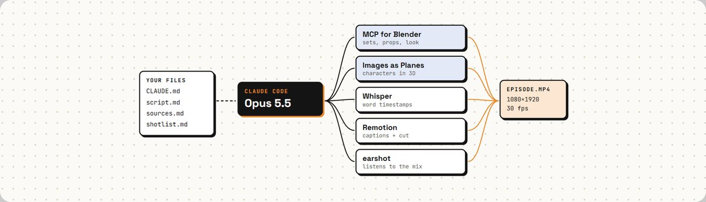</p>

### 04. Write the house rules once

Claude Code reads CLAUDE.md on every run. Put the format in it, so every episode starts from the same rules. [Claude Code memory docs](https://code.claude.com/docs/en/memory)

```
# 2.5D shorts studio

## Format
- 1080x1920, 30 fps, 55-70 seconds. Render at exactly this size, never crop or upscale.
- Flat 2D characters inside lit 3D sets. Characters never get realistic shading.
- A new shot on every new idea in the script, roughly every 2 seconds.
- Camera: slow push-in or dolly with a reason. No random drift, no constant orbit.

## Story
- True stories only. Every claim in the script gets a source in sources.md.
- The first line is the hook. The last line pays it off.

## Look
- Sets: one motivated key light, warm practicals (candles, windows, torches), depth of field.
- Materials have wear and variation. Nothing perfectly clean.
- Characters: flat colour, thick dark outline, a contact shadow on the floor so they sit in the set.

## Banned
- Centered title on a gradient. Corner labels, timecodes, frame borders.
- Everything fading in. A whoosh on every cut.
- Any number or claim on screen that is not in sources.md.

## Review before I see anything
1. Contact sheet, one frame per second. Look at it.
2. List every problem with a timestamp. Fix the 3 worst. Repeat.
```

## Part 3 - Story first

<p align="center"><a href="https://raw.githack.com/HossamSalemOnline/Opus-5.5/main/docs/media/e002-v3-part3.mp4"></a><br>
<sub>▶ Part 3 title card, 4 s · <a href="https://raw.githack.com/HossamSalemOnline/Opus-5.5/main/docs/media/e002-v3-part3.mp4">MP4</a></sub></p>

### 05. The script is 160 words

A 65-second short read at a normal pace is about 150-170 words. That is the whole budget. Opus is very good at this if you force it to show its sources:

<p align="center">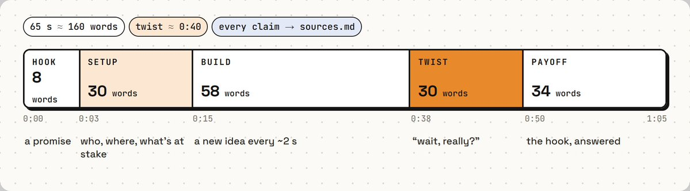</p>

```
Find 5 true stories from history or science that fit this title pattern:
"The [object] That [did something surprising]" or "Why [thing] Always [does X]".

For each: one line on the story, why a 12-year-old and a 50-year-old would
both repeat it, and 2 sources I can open.

Then write the script for the one I pick:
- 150-170 words, one narrator, spoken English, short sentences
- line 1 is the hook and makes a promise
- a twist around second 40
- the last line pays off the hook
- write sources.md with a source for every factual claim
```

Check the sources yourself. This is the one step you never hand off completely.

### 06. Turn the script into shots

Now split the script into shots, one per idea. This becomes the contract for everything after it:

```
Split script.md into a shot list. One shot per idea, 1.5-3 seconds each.

For every shot write:
  id, words it covers, duration
  SET        which 3D set and where in it
  CAMERA     framing + move (push-in / dolly / static), with the reason
  CHARACTER  who is on screen, pose, expression from the expression sheet
  PROP       any hero object (it must be built in 3D, not drawn)
  SOUND      only if something physical happens

Reuse sets. A 65s episode should need 3-5 sets, not 30.
```

Then write the key beats in frames, not seconds. Here is a worked example for one beat of my own version of the story, at 30 fps. These are my starting numbers, not measured from the original:

```
GLOBAL FRAME   TIME     EVENT
1215           40.5s    SHOT 18 starts: wide on the jar, night, court asleep
1230           41.0s    push-in begins, scale 1.00 -> 1.06 over 60 frames
1248           41.6s    the west dragon's mouth opens
1254           41.8s    the ball drops
1262           42.1s    the ball hits the frog (hit sound on this frame)
1266           42.2s    CUT to SHOT 19: the inventor's eyes open
1272           42.4s    caption "dropped" fully readable
1290           43.0s    hold ends, cut
```

Physics keeps you honest here. A ball falling about 30 cm takes roughly a quarter of a second, so 7-8 frames at 30 fps. Make it slower and it reads as floaty, which viewers feel even when they can't name it.

Now every revision is a number. "Move the hit to 1260" is an edit an agent can't misread.

## Part 4 - Build the world in Blender

<p align="center"><a href="https://raw.githack.com/HossamSalemOnline/Opus-5.5/main/docs/media/e002-v4-part4.mp4">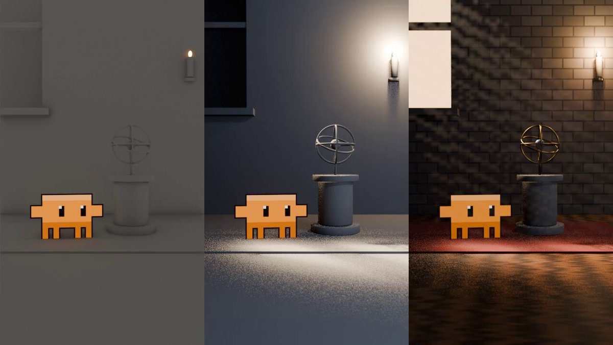</a><br>
<sub>▶ Part 4 title card, 4 s · <a href="https://raw.githack.com/HossamSalemOnline/Opus-5.5/main/docs/media/e002-v4-part4.mp4">MP4</a></sub></p>

### 07. Sets through MCP: block, light, then dress

MCP for Blender runs a small server inside Blender. Claude writes Blender Python itself, and the MCP adds what Python cannot do alone: **look** shows it the viewport, the camera, a multi-angle sheet or an animation strip, and **search_assets** pulls real Poly Haven HDRIs and textures.

That look tool is the whole game. The agent checks its own work instead of guessing. [MCP for Blender README](https://github.com/ahujasid/mcp-for-blender)

Poly Haven assets are CC0, so you can use them in a monetized video without credit. [Poly Haven license](https://polyhaven.com/license)

Anthropic's own Alex Albert showed how far this already goes on launch day:

> **[Embedded post]** [@alexalbert__](https://x.com/alexalbert__/status/2102458348511879448) · Tue 22 Sep 2026 · 272,346 views · 2,652 likes
>
> I just realized Opus 5.5 can use Blender to make claymations with just a single prompt in claude dot ai now

<p align="center"><a href="https://raw.githack.com/HossamSalemOnline/Opus-5.5/main/docs/media/ref-alexalbert-blender-claymation.mp4">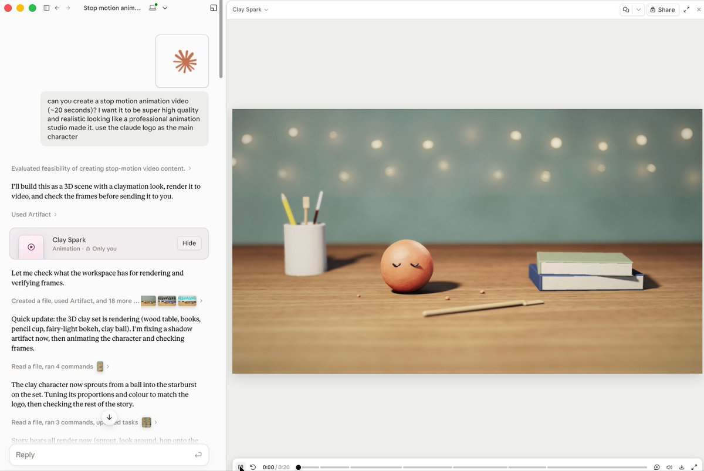</a><br>
<sub>▶ Blender claymation from one prompt, 22 s · <a href="https://raw.githack.com/HossamSalemOnline/Opus-5.5/main/docs/media/ref-alexalbert-blender-claymation.mp4">MP4</a></sub></p>

Build each set in passes, and stop after each one:

<p align="center">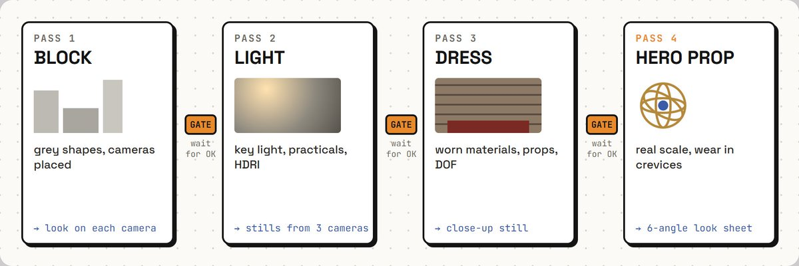</p>

```
You are building SET 2 (the throne room) for a vertical 2.5D short, in Blender through MCP.

Pass 1, BLOCK: grey shapes for walls, throne, pillars, floor. Place every camera from
shotlist.md. Use look on each camera and send me a sheet.

Pass 2, LIGHT: one motivated key light (the windows), warm practicals (candles, torches),
a Poly Haven HDRI for fill. No 3-point studio light. Send stills from 3 cameras.

Pass 3, DRESS: materials with wear and variation, banners, carpet, small props.
Depth of field on every camera, focused where the character will stand.

Render size is 1080x1920. Never render bigger and crop.
```

### 08. Hero props are 3D, always

In the jar video the jar itself is a proper 3D object: bronze, gold dragons, frogs at the base. It gets close-ups, lighting and its own moment.

That is a rule worth stealing. The thing the story is about is never a flat drawing. Ask for it as its own build, with a turntable check before it goes into a set:

```
Build the hero prop for this episode: [object, with a reference image or description].
Real-world scale. Bevel every edge. Material with wear in the crevices.
Render a 6-angle look sheet on a neutral floor. Then place it in SET 2 at the mark.
```

## Part 5 - Put 2D characters in 3D

<p align="center"><a href="https://raw.githack.com/HossamSalemOnline/Opus-5.5/main/docs/media/e002-v5-part5.mp4">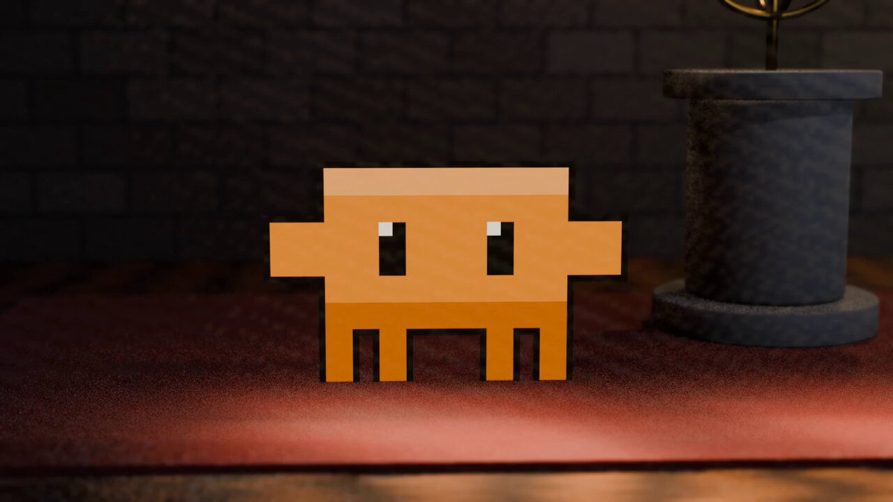</a><br>
<sub>▶ Part 5 title card, 4 s · <a href="https://raw.githack.com/HossamSalemOnline/Opus-5.5/main/docs/media/e002-v5-part5.mp4">MP4</a></sub></p>

### 09. The cut-out ri

This is the core of the 2.5D look. The characters are flat images on planes, standing inside the 3D set.

Blender does this natively: Import Images as Planes with the Emit or Shadeless shader, so the set lights never shade them, plus a soft contact shadow under the feet so they sit on the floor instead of floating. [Blender manual: Images as Planes](https://docs.blender.org/manual/en/latest/modeling/meshes/import_images_as_planes.html)

<p align="center">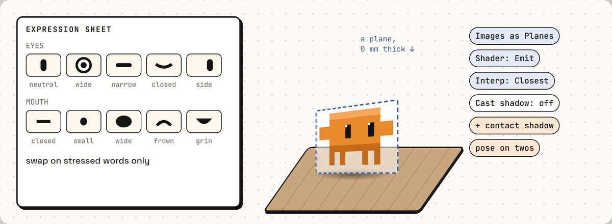</p>

Faces work like old-school replacement animation: a set of eyes and mouths that swap per beat. Have Opus draw them as SVG first

```
Design a cartoon character as separate SVG parts on transparent backgrounds:
head (one round shape), body, arms, legs, hat or costume for [role, era].

Expression sheet, each as its own file:
  eyes:  neutral, wide, narrow, closed, side-look
  mouth: closed, small open, wide open, frown, grin
  extra: sweat drop, blush

Style rules: flat colour, one thick dark outline weight, no gradients, no textures.
Export PNGs at 2x, then import every part into Blender as planes on one rig.
```

### 10. Acting, not bouncing

The fastest way to spot generated 2D: the character never thinks. It bounces, waves and smiles, but nothing happens in its face before it moves.

```
Before you animate, write an acting line for every shot:

SHOT 07 (2.1s)  "the whole court laughed"
  thought:      the inventor knows he's right
  anticipation: eyes narrow first, 4 frames before anything else moves
  action:       head turns to camera on the word "laughed"
  hold:         stay on the look for 10 frames so it reads

Rules: no idle bounce. Every move starts with a look. Swap mouths only on stressed words.
```

For a hand-painted variant of the same idea, JohnHeibel's ClaudeAnimationBase (p5.js + p5.brush, 31 acted emotions) and the painted-animation skill from opus-video-skills are worth reading line by line.

## Part 6 - Voice, captions, sound

<p align="center"><a href="https://raw.githack.com/HossamSalemOnline/Opus-5.5/main/docs/media/e002-v6-part6.mp4">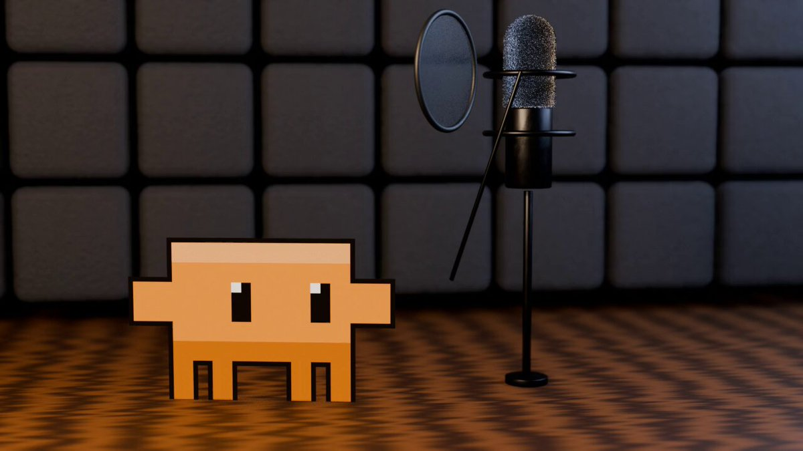</a><br>
<sub>▶ Part 6 title card, 4 s · <a href="https://raw.githack.com/HossamSalemOnline/Opus-5.5/main/docs/media/e002-v6-part6.mp4">MP4</a></sub></p>

### 11. Your voice, word-timed captions

Record the script yourself. A real voice with real breaths is the single biggest trust signal in the format, and it keeps you clear of any voice-clone questions.

Then let Whisper give you a timestamp for every word, and build the caption layer from that file. [Whisper README](https://github.com/openai/whisper)

<p align="center">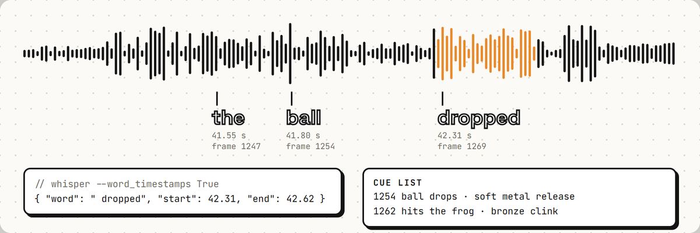</p>

```
whisper voice.wav --model small --word_timestamps True --output_format json --output_dir captions/
```

```
Read captions/voice.json. Build the caption layer in Remotion:
- 1-2 words on screen at a time, cut exactly on each word's start time
- bold white, dark outline, centre-low, inside the 9:16 safe area
- no pop-in animation on every word, only on stressed words
Then line up every shot cut in shotlist.md with the word it belongs to.
```

### 12. Sound that lands

Most AI films look done with the sound off. Turn it on and the cuts miss the beat and the last frame lands before the music resolves.

earshot is an open-source MCP that lets a coding agent listen to audio, review it and make sound, CPU only. Use it as the ears of your review:

```
Listen to out/mix.wav with earshot and check it against shotlist.md:
- the voice is always on top, music sits under it
- a sound only where something physical happens (a ball drops, a door slams)
- no whoosh repeated more than twice
- the music resolves on the final frame
```

Write the cues next to the picture events, in the same frame numbers:

```
BALL DROP      frame 1254    soft metal release
FROG HIT       frame 1262    bronze clink, strongest transient here
EYES OPEN      frame 1266    music drops out for 20 frames
FINAL LINE     frame 1920    music resolves
```

A soft lead-in on a sound file shifts its audible hit. Find the hit on the waveform and offset the clip so the peak lands on the frame.

## Part 7 - The review loop

<p align="center"><a href="https://raw.githack.com/HossamSalemOnline/Opus-5.5/main/docs/media/e002-v7-part7.mp4">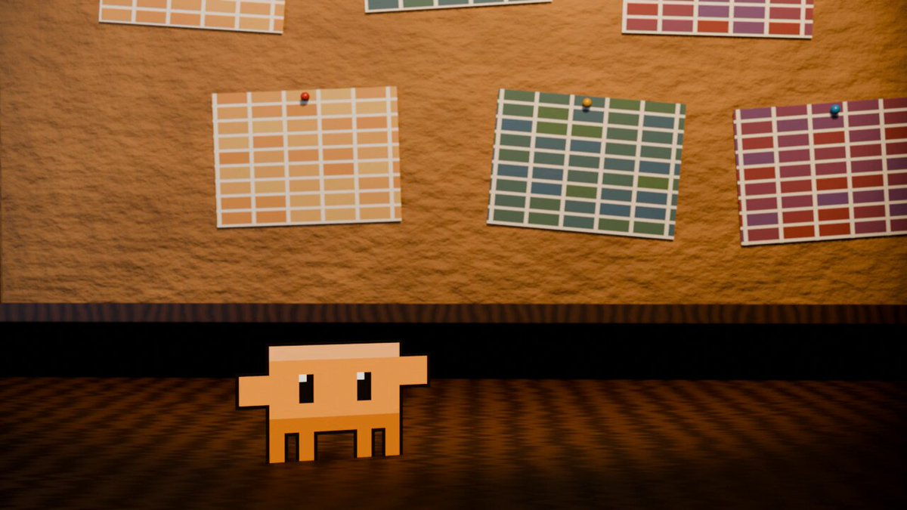</a><br>
<sub>▶ Part 7 title card, 4 s · <a href="https://raw.githack.com/HossamSalemOnline/Opus-5.5/main/docs/media/e002-v7-part7.mp4">MP4</a></sub></p>

### 13. Make the frames come to you

Never watch a full export ten times. Look at sheets:

```
# One frame per second, the whole episode on one image
ffmpeg -i out/episode.mp4 -vf "fps=1,scale=240:-1,tile=8x9" -frames:v 1 review/contact.png

# Phone test: how it reads at 360 px wide
ffmpeg -i out/episode.mp4 -vf "fps=1/3,scale=360:-1,tile=6x4" -frames:v 1 review/phone.png
```

<p align="center">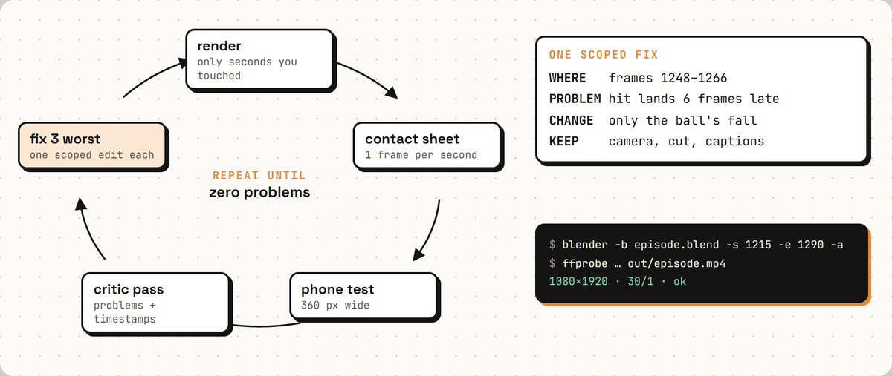</p>

[FFmpeg filters docs](https://ffmpeg.org/ffmpeg-filters.html)

When you fix something, never re-render the whole episode. Blender renders a single frame or a range from the command line:

```
# one still at the frog hit
blender -b episode.blend -o //review/still_ -f 1262

# only the seconds around the fix (start and end before -a)
blender -b episode.blend -o //review/fix_ -s 1215 -e 1290 -a
```

[Blender command line arguments](https://docs.blender.org/manual/en/latest/advanced/command_line/arguments.html)

Then hand the sheets to Opus as a critic, not as the author:

```
Open review/contact.png and review/phone.png.
You did not make this. You are the harshest animation director I know.

Check: does every character sit on the floor (contact shadow)? Is any character
lit like a 3D object? Does any shot last longer than 3s without a new idea?
Are captions readable at phone size? Is any claim on screen missing from sources.md?

List every problem with a timestamp. Fix the 3 worst.
Re-render only those seconds. Show me the new sheet.
```

Give every correction four fields: where, what is wrong, what changes, and what must stay fixed. An agent with a scoped edit doesn't wander:

```
Revise SHOT 18 using shotlist.md.
WHERE      global frames 1248-1266
PROBLEM    the ball hits the frog at 1268, 6 frames after the hit sound at 1262
CHANGE     only the ball's fall: start at 1254, contact at 1262, ease-in (gravity), no bounce
KEEP       camera push-in, the cut at 1266, the caption timing, every other shot

Render stills at 1254, 1258, 1262, 1266 and a preview of 1215-1290.
Check the in-between frames for jumps. Report what changed and the output files.
```

<p align="center"></p>

Fix in this order: anything wrong or missing first, then readability, then timing, then visual detail.

When the episode is approved, check the export before you upload it:

```
ffprobe -v error -select_streams v:0 -show_entries stream=width,height,avg_frame_rate,duration -of json out/episode.mp4
```

You should see 1080 by 1920, a frame rate of 30/1 and the duration you planned. [ffprobe docs](https://ffmpeg.org/ffprobe.html)

Once the loop works, package it so the next episode is one line:

```
---
name: cartoon-studio
description: Make a vertical 2.5D animated short (flat 2D characters in lit 3D Blender
  sets) about a true story. Use when the user asks for a history or science short,
  an animated explainer or a story episode.
---

# 2.5D short

## Pipeline
1. Pitch 5 true stories with sources. Wait for my pick.
2. script.md (150-170 words) + sources.md. Wait for OK.
3. shotlist.md: one shot per idea, 3-5 reusable sets.
4. Sets in Blender: BLOCK -> LIGHT -> DRESS, look sheet after each pass.
5. Hero prop in 3D. Characters as SVG parts -> planes, flat material, contact shadow.
6. Acting line per shot, then animate.
7. My voice -> whisper word timestamps -> captions -> mix, checked with earshot.
8. Contact sheet + phone test -> critic pass -> fix 3 worst -> repeat.

## Hard rules
- 1080x1920, render at size. True claims only, each in sources.md.
- Never copy another channel's characters, designs or scripts.
```

Save it as ~/.claude/skills/cartoon-studio/SKILL.md and call it with /motion-studio.

One story in. One episode out. One person.

## Part 8 - Your first episode

Don't plan a channel. Make one episode end to end, then decide.

- **Pick a story you'd tell a friend anyway.** If it doesn't make you say "wait, really?", it won't make a stranger stop scrolling.
- **Time the whole job.** Write down the hours for story, sets, characters, animation, voice, sound and review. The second episode tells you what the first one really cost.
- **Keep the paperwork with the video.** script.md, sources.md, shotlist.md, the cue list and the approved export live in one folder. That folder is your template for episode two.
- **Watch it like a viewer.** Normal speed, on your phone, sound on. Then once more with your eyes closed.
- **Learn from the graph, not from the view count.** After it's live, YouTube Studio's audience retention shows the exact second people leave. Fix that kind of shot in the next episode.

## Part 9 - Stay on the right side of the platform

This part decides whether the channel lasts.

- **Take the grammar, never the content.** Study how a channel frames, cuts and captions. Never copy its characters, designs or scripts.
- **Original episodes, not templates.** YouTube's monetization rules target mass-produced, repetitive content. A real story, your voice and new sets every episode are what keep you clear. [YouTube monetization policies](https://support.google.com/youtube/answer/1311392)
- **Know the AI label.** YouTube's disclosure is for realistic altered content. Clearly unrealistic content like animation is generally exempt, but if anything could be mistaken for real footage, label it. [YouTube on AI disclosure](https://blog.youtube/news-and-events/disclosing-ai-generated-content/)
- **Facts stay facts.** sources.md is not busywork. One wrong date in the comments costs you more trust than any render can buy back.

## Repos to clone

All open, all checked on October 27, 2026:

| What | Repo |
|---|---|
| Blender control | [github.com/ahujasid/mcp-for-blender](https://github.com/ahujasid/mcp-for-blender) |
| Claymation in Blender (great for studying a Blender SKILL.md) | [github.com/angrypenguinpng/blender-claymation-skill](https://github.com/angrypenguinpng/blender-claymation-skill) |
| Animation principles | [github.com/LottieFiles/motion-design-skill](https://github.com/LottieFiles/motion-design-skill) |
| GSAP official skills | [github.com/greensock/gsap-skills](https://github.com/greensock/gsap-skills) |
| Video assembly | [github.com/remotion-dev/skills](https://github.com/remotion-dev/skills) |
| HTML video framework | [github.com/heygen-com/hyperframes](https://github.com/heygen-com/hyperframes) |
| Hand-painted 2D | [github.com/JohnHeibel/ClaudeAnimationBase](https://github.com/JohnHeibel/ClaudeAnimationBase) |
| Painted + kinetic skills | [github.com/tuzhechen2005/opus-video-skills](https://github.com/tuzhechen2005/opus-video-skills) |
| Sound for agents | [github.com/Leonxlnx/earshot](https://github.com/Leonxlnx/earshot) |
| Word timestamps | [github.com/openai/whisper](https://github.com/openai/whisper) |
| 59 film styles made in code | [github.com/lemomo-ai/lemo-opuscar](https://github.com/lemomo-ai/lemo-opuscar) |
| 180 video skills, graded | [github.com/zhuyansen/awesome-claude-video-skills](https://github.com/zhuyansen/awesome-claude-video-skills) |

<sub>The author lists these as plain lines; shown here as a table with the same labels and links.</sub>

And if you want to see how wide this goes, Claude's own account collected some of the best things people built in the first week:

> **[Embedded post]** [@claudeai](https://x.com/claudeai/status/2103515655760982273) · Fri 25 Sep 2026 · 2,528,285 views · 19,964 likes
>
> Claude Opus 5.5 has been out for a few days. Some of our favorite things people have explored and discovered with it so far:
>
> https://x.com/RyanSael/status/2102591147927654847
>
> > **Quoted post,** [@RyanSael](https://x.com/RyanSael/status/2102591147927654847):
> >
> > I asked Opus 5.5 to explain camera focus by building an interactive lens lab
> >
> > Here's what it came up with after 1 hour 26 minutes in one shot, $25.66 API cost
> >
> > Move the focus ring and you can see the glass elements shift the sharp plane through the scene

## The real shift

A year ago a short like the jar video needed a modeller, an animator, a lighter and an editor.

Now it needs a true story, your voice, Blender, Opus 5.5 and the patience to review your own frames.

The tools are free. The story, the taste and the honesty are still on you, and that's exactly why the format keeps working.

Bookmark this before your first episode. You will want the house rules open next to the viewport.

**Stay tuned for more content, I'm just getting started :)**
